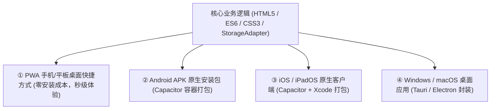

# 多应用生态与架构演进蓝图 (App Suite Architecture Blueprint)

本文档规划了 `D:\fs` 工作空间的多应用组织架构、版本管理体系、跨平台演进路径与多应用融合方案。

---

## 一、 工作空间目录规范

为了防止多应用开发时根目录杂乱，`D:\fs` 统一采用**应用独立模块化目录结构**：

```text
D:\fs\
├── timemirror\                  # 【应用 1】《时镜 TimeMirror》24h时间图谱与自我反思 APP
│   ├── index.html               # 核心界面
│   ├── app.js                   # 状态流转与 StorageAdapter 数据层
│   ├── style.css                # 移动端自适应与设计规范
│   ├── manifest.json            # PWA 桌面化配置
│   ├── sw.js                    # 离线缓存服务
│   ├── server.py                # 本地多端服务引擎
│   └── 启动服务.bat              # 子目录独立启动快捷方式
│
├── 启动时镜APP.bat              # 根目录一键启动快捷方式（直接双击即可）
│
├── apps\                        # 【未来新应用预留目录】
│   ├── habitflow\               # 未来应用2：习惯养成与微习惯追踪（示例）
│   ├── flashnotes\              # 未来应用3：闪念胶囊与灵感记事（示例）
│   └── hub\                     # 未来应用矩阵聚合中心（App Suite Hub）
│
└── APPS_ARCHITECTURE.md         # 架构与演进总纲（即本文档）
```

---

## 二、 版本迭代与更新日志机制 (Version & Changelog)

### 1. 语义化版本规则 (Semantic Versioning)
所有应用严格遵循 `v主版本.次版本.修订版本`（例如 `v1.0.0`）：
* **主版本号 (Major)**：架构重大变更（如跨平台客户端打包、云端同步大版本）。
* **次版本号 (Minor)**：新增关键功能模块（如上线自定义调色板、长图分享、周报透视）。
* **修订号 (Patch)**：体验微调、小 Bug 修复与交互顺滑度提升。

### 2. 应用内更新日志 (In-App Changelog)
用户在应用主界面点击顶部版本号标签（如 `v1.0.0 · 体验版`）或在【设置】->【版本与迭代中心】，即可唤起可视化更新日志弹窗，清楚了解：
- 本次版本新增了什么特性；
- 解决了哪些历史痛点；
- 下一版本正在规划中的功能清单。

---

## 三、 跨平台延伸方案 (iOS / iPad / Windows / Android)

应用当前采用**现代化 Web 标准 + PWA（渐进式 Web 应用）**架构构建，这是一种最高效的“一次编写，到处运行”底层标准：



* **Android / iOS / iPad 封装**：未来只需引入 `@capacitor/cli`，无需改动现有时间流与复盘代码，直接编译生成 Android `.apk` 和 iOS `.ipa`。
* **Windows 桌面端封装**：未来可通过 Tauri 将其打包为极轻量（仅几兆大小）的 Windows `.exe` 安装包，支持开机启动、系统托盘悬浮计时。

---

## 四、 多设备云端同步架构预留 (Sync Engine & Storage Adapter)

为保障个人隐私，目前系统采用 **本地优先（Local-First）** 存储。在底层代码中已经解耦出 `StorageAdapter` 数据适配器：

```javascript
// 已预留的数据适配器接口
const StorageAdapter = {
  mode: 'local', // 切换为 'cloud' 即可平滑支持多端同步
  load(key, fallback) { ... },
  save(key, data) {
    // 预留云端同步钩子:
    // if (this.mode === 'cloud') CloudSyncEngine.push(key, data);
  }
};
```

**未来的云端接入策略**：
1. **私有云 WebDAV 同步**：支持挂载坚果云、Nextcloud 或个人 NAS，数据只掌握在自己手里。
2. **端到端加密云数据库（Supabase / CouchDB）**：数据在离开手机前加密，云端仅作中转同步，实现 iPhone、安卓手机、Windows 电脑间实时无感同步。

---

## 五、 多应用矩阵融合方案 (App Suite / Modular Fusion)

随着未来更多工具的产生（如习惯打卡、随身笔记、财务记账等），我们将采用**微前端/模块化聚合模式**：

1. **统一设计语言（Unified Design System）**：
   各个应用共享同一套色彩、圆角、阴影、微动画和黄金拇指交互规范，保持视觉与手感的高度统一。
2. **应用间数据总线（Data Bus）**：
   例如：在“习惯打卡应用”中打卡了一次慢跑，“时镜 TimeMirror”自动同步生成一条 `18:00 - 18:40 运动锻炼` 的时间块，实现无感联动！
3. **聚合中枢（Hub Dashboard）**：
   未来可提供一个一站式首页导航，将所有独立工具汇聚为一个强大的个人数字化生活操作系统。
