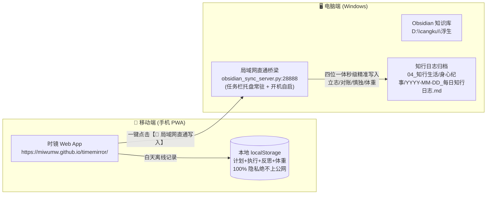

# 🧭 《时镜 TimeMirror》跨会话认知与演化枢纽 (Living Context Hub)

> **文档性质**：面向多智能体（AI Pair Programmer）与开发者跨会话接力的活态系统枢纽。  
> **维护规则**：AI 需根据用户对话与功能演进**自发、主动增删修改**，无需等待用户催促，始终保持信息最新。  
> **当前版本**：v1.2.0 · 知行三段与身心体态版  
> **更新时间**：2026-11-10 17:55

---

## 一、系统全貌与双仓协同结构

本项目连接了两个独立但紧密协作的系统：

---

## 二、当前重大里程碑与已验证成果 (Verified Milestones)

- [x] **24小时时间图谱**：连续色块瀑布流，支持空白间隙自动感知与一键补录。
- [x] **移动端黄金交互**：卡片整块轻触即触发编辑抽屉，内置 `+15m ~ +1.5h` 快捷步进，大号防误触删除。
- [x] **全能活动分类系统**：自定义增删改分类，图标/颜色自由配置，摸鱼/专注分类智能标记。
- [x] **知行三段合流整屏大架构 (v1.2.0)**：
  - 清理原旧版“睡前复盘与自我对话”（5星打分与3道72px小框）；
  - 重塑为整屏三大黄金段落：**🎯 晨起立志（今日计划）**、**⚡ 暮夜对账（实际执行）**、**🪞 诚意慎独（今日反思）**；
  - 完美映射用户本地 Obsidian `YYYY-MM-DD_每日知行日志.md` 的第一部分结构。
- [x] **每日晨起体重追踪与双图表 (v1.2.0)**：
  - 支持晨起记录体重（kg，支持 ±0.1 快捷微调），自动与前日比对增减；
  - 在复盘卡片提供近 14 天体重走势图，在趋势洞察页提供近 30 天体重深度曲线；
  - 同步时自动写入 Obsidian Frontmatter `weight:` 与正文【1. 晨起体感与起居】下的 `- **晨起体重**：xx kg`。
- [x] **四位一体全量局域网直通 (v1.2.0)**：
  - 手机点击直通写入，一次性精准同步【计划 + 执行流水 + 反思 + 体重】，安全幂等更新。
- [x] **🎉 线上到本地直通通道（保持封版稳定）**：
  - 手机访问 GitHub Pages 线上地址（`https://miwumw.github.io/timemirror/`）；
  - 局域网直通稳定顺畅，通信层协议已完全固化。

---

## 三、关键配置文件与参数速查

1. **服务配置 (`obsidian_sync_server.py`)**：
   - 监听端口：`PORT = 28888`
   - 监听地址：`0.0.0.0`
   - 绑定知识库：`D:\cangku\浮生`
   - 日记保存相对路径：`04_知行生活\身心纪事`
   - 模板路径：`D:\cangku\浮生\04_知行生活\身心纪事\_每日终极知行模板.md`
   - 对账插入锚点：`### ⚡ 暮夜对账（实际做了什么？）`
2. **启动与托盘控制**：
   - 启动脚本：`启动时镜Obsidian同步服务.bat`（调用 `pythonw.exe` 静默启动，无黑框弹出）
   - 开机启动快捷方式：`%APPDATA%\Microsoft\Windows\Start Menu\Programs\Startup\时镜Obsidian同步服务.lnk`
3. **前端代码 (`D:\fzl\fs\timemirror`)**：
   - 入口页面：`index.html`
   - 业务逻辑：`app.js`
   - 样式与暗黑适配：`style.css`
   - 离线缓存：`sw.js`（缓存版本控制，更新需自增版本号）

---

## 四、未来可能演进的探索方向（待用户需求触发）

> [!NOTE]
> 当前阶段首要原则是**保持当前体验的稳定与顺畅**。以下内容为后续潜在储备方向，未经用户主动提出前不要提前铺设：

1. **数据深度分析**：
   - 周维度/月维度专注度走势图、时间利用率趋势。
   - 摸鱼黑洞易发时段热力图（例如上午 11:00 或晚上 22:00）。
2. **知行日记逆向联动**：
   - 若用户在 Obsidian 里修改了对账内容，是否需要反向同步回时镜（暂不建议，单向推送最省心）。
3. **PWA 体验微雕**：
   - 针对 Redmi Note 9 屏幕尺寸与触控震动反馈的细节优化。

---

## 五、AI 助手交接指引与自主演进备忘

1. **新对话第一动作**：
   - 查阅本文件与 `AGENTS.md`，了解当前系统已处于“线上 PWA 手机直通电脑 Obsidian 成功”的状态。
   - 不要向用户建议推翻局域网直通机制，也不要再引导用户尝试复杂的外部方案。
2. **主动更新原则**：
   - 每次对话产生了新的功能实现或架构调整，AI 必须在回答结束前**主动修改本文件**，更新日期、版本与里程碑。
   - 若某个假设已被证伪或废弃，直接从本文件中删除，保持知识的高信噪比。
