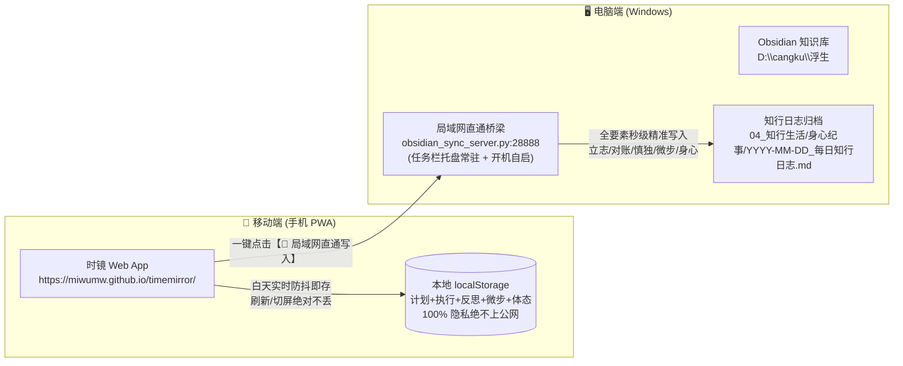

# 🧭 《时镜 TimeMirror》跨会话认知与演化枢纽 (Living Context Hub)

> **文档性质**：面向多智能体（AI Pair Programmer）与开发者跨会话接力的活态系统枢纽。  
> **维护规则**：AI 需根据用户对话与功能演进**自发、主动增删修改**，无需等待用户催促，始终保持信息最新。  
> **当前版本**：v1.3.2 · 身心症状与过程写入增强版  
> **更新时间**：2026-11-14 20:55

---

## 一、系统全貌与双仓协同结构

本项目连接了两个独立但紧密协作的系统：

---

## 二、当前重大里程碑与已验证成果 (Verified Milestones)

- [x] **整日身心状态与症状 + 情绪耐受过程专属输入框 (v1.3.1 彻底解耦与全量直通)**：
  - 在身心状态卡片增设【整日身心状态与症状】与【情绪耐受度具体过程】双专属输入域，从复盘反思解耦独立，打字实时防抖持久化、空值抹除防御、绝不丢失；
  - 彻底查明直通服务常驻进程代码版本滞后根因，平滑重启同步托盘服务至 v1.3.0/v1.3.1，打通微步打卡与身心芯片全量精准入库 Obsidian 对应章节。
- [x] **24小时时间图谱与顶栏超薄轻量化 (v1.3.0 键盘避让突破)**：
  - 顶栏全天图谱与快捷统计下沉为时间流专属卡片，吸顶栏缩减至 48px 超薄日期条；
  - 彻底根除移动端输入反思文本时键盘上抬导致字被顶栏遮挡的痛点，加入 56px 滚动呼吸区。
- [x] **践行微步·分级打卡系统 (v1.3.0 融合极简打卡模板)**：
  - 落地 🟢【保底线】3 基础步（冥想、八段锦、体态调整 3 动作）与 🟡【进阶项】4 加分步（易筋经、马步、睡前冥想、囚徒健身）；
  - 手机大触控打勾即存，保底线达成即获成就徽章。
- [x] **晨起身心体态 30 秒快捷追踪 (v1.3.0)**：
  - 融合空腹体重、晨起精力（1~5）、鼻腔通气、体态自觉（1~5）、情绪应激与平复时差芯片化点选。
- [x] **四位一体全量局域网直通双端升级 (v1.3.0)**：
  - 更新 `_每日终极知行模板.md` 与本地同步桥梁 `obsidian_sync_server.py`，实现手机打卡后直通更新日记第一、二、三部分，顺畅无冲突。

- [x] **24小时时间图谱**：连续色块瀑布流，支持空白间隙自动感知与一键补录。
- [x] **移动端黄金交互**：卡片整块轻触即触发编辑抽屉，内置 `+15m ~ +1.5h` 快捷步进，大号防误触删除。
- [x] **全能活动分类系统**：自定义增删改分类，图标/颜色自由配置，摸鱼/专注分类智能标记。
- [x] **知行三段合流整屏大架构 (v1.2.0)**：
  - 清理原旧版“睡前复盘与自我对话”（5星打分与3道72px小框）；
  - 重塑为整屏三大黄金段落：**🎯 晨起立志（今日计划）**、**⚡ 暮夜对账（实际执行）**、**🪞 诚意慎独（今日反思）**；
  - 完美映射用户本地 Obsidian `YYYY-MM-DD_每日知行日志.md` 的第一部分结构。
- [x] **无感实时持久化与长效草稿沉淀 (v1.2.2 核心痛点根治)**：
  - 彻底解决“打完字刷新或切屏丢失”的问题，今日计划与反思实现**敲键盘即刻实时存入 localStorage**；
  - 配合 `beforeunload` 与 `visibilitychange` 双重瞬时刷盘保险，支持一天多次、随时打开随时追加记录；
  - 新增输入框自动高度向下撑开与 `🟢 实时已存` 微呼吸状态指示。
- [x] **草稿深度防丢与历史版本快照保险箱 (v1.2.3 根治空值覆盖与误删)**：
  - **根因根除**：修复非复盘页面息屏/切后台时未初始化的空输入框覆写已存数据的 Bug（严格仅允许当前在复盘页时刷盘，并加入初载填充与非空防御）；
  - **历史版本快照**：打字实时备份生成带时间戳快照存入本地快照保险箱（保留 40 条版本），提供 `📜 历史版本/找回` 弹窗支持一键对比找回并恢复；
  - **移除清空危险项**：移除易误触的“清空”按钮，杜绝滑屏时手指误触风险；
  - **跨天防迷失横幅**：切到历史日期时醒目黄色横幅提示并提供 `回到今天 ➜`。
- [x] **每日晨起体重追踪与双图表 (v1.2.0)**：
  - 支持晨起记录体重（kg，支持 ±0.1 快捷微调），自动与前日比对增减；
  - 在复盘卡片提供近 14 天体重走势图，在趋势洞察页提供近 30 天体重深度曲线；
  - 同步时自动写入 Obsidian Frontmatter `weight:` 与正文【1. 晨起体感与起居】下的 `- **晨起体重**：xx kg`。
- [x] **四位一体全量局域网直通 (v1.2.0)**：
  - 手机点击直通写入，一次性精准同步【计划 + 执行流水 + 反思 + 体重】，安全幂等更新。
- [x] **🎉 线上到本地直通通道（保持封版稳定）**：
  - 手机访问 GitHub Pages 线上地址（`https://miwumw.github.io/timemirror/`）；
  - 局域网直通稳定顺畅，通信层协议已完全固化。
- [x] **🧘 浮生体态修正系统建立 (v1.2.1)**：
  - 落地于 `04_知行生活/身心纪事/体态修持/`；
  - 包含《🪞_体态评测与蜕变总览》、三大对症动作库（足弓/骨盆、脊柱/胸廓、头面/咬肌）、资产存放规范及 Dataview 碎片化聚合。
- [x] **📚 浮生修学四阶全景书架 (Dataview 智能流转版) (v1.2.1)**：
  - 落地于 `04_知行生活/个人管理/📚_浮生修学四阶全景书架_动态版.md`；
  - 影院海报卡片流（视频学习 ➔ 整理笔记 ➔ 背诵记忆 ➔ 演讲分析）；
  - 9 门大课元数据录入，支持双按钮直达（全局目录 + 正在学单篇讲稿）；
  - 《黄帝内经》四阶四层层级展开 MOC Demo 落地。
- [x] **🎯 倪师临证对症奇穴与离子球治症总盘建立 (v1.2.2)**：
  - 落地于 `01_中医人纪/🎯_倪师临证对症奇穴与离子球治症总盘.md`；
  - 彻底解决“小妙招散落全篇无法记忆”的痛点，完全脱离高亮标记；
  - 深度精读《针灸大成》3700+行手记与《黄帝内经》素问手记，按“靶心病症”提取急救、头面、筋骨、脏腑、妇科、皮科六大板块首批实战绝活。

---

## 三、关键配置文件与参数速查

1. **服务配置 (`obsidian_sync_server.py`)**：
   - 监听端口：`PORT = 28888`
   - 监听地址：`0.0.0.0`
   - 绑定知识库：`D:\cangku\浮生`
   - 日记保存相对路径：`04_知行生活\身心纪事`
   - 模板路径：`D:\cangku\浮生\04_知行生活\身心纪事\_每日终极知行模板.md`
   - 对账插入锚点：`### ⚡ 暮夜对账（实际做了什么？）`
2. **启动与托盘控制**：
   - 启动脚本：`启动时镜Obsidian同步服务.bat`（调用 `pythonw.exe` 静默启动，无黑框弹出）
   - 开机启动快捷方式：`%APPDATA%\Microsoft\Windows\Start Menu\Programs\Startup\时镜Obsidian同步服务.lnk`
3. **前端代码 (`D:\fzl\fs\timemirror`)**：
   - 入口页面：`index.html`
   - 业务逻辑：`app.js`
   - 样式与暗黑适配：`style.css`
   - 离线缓存：`sw.js`（缓存版本控制，更新需自增版本号）

---

## 四、未来可能演进的探索方向（待用户需求触发）

> [!NOTE]
> 当前阶段首要原则是**保持当前体验的稳定与顺畅**。以下内容为后续潜在储备方向，未经用户主动提出前不要提前铺设：

1. **数据深度分析**：
   - 周维度/月维度专注度走势图、时间利用率趋势。
   - 摸鱼黑洞易发时段热力图（例如上午 11:00 或晚上 22:00）。
2. **知行日记逆向联动**：
   - 若用户在 Obsidian 里修改了对账内容，是否需要反向同步回时镜（暂不建议，单向推送最省心）。
3. **PWA 体验微雕**：
   - 针对 Redmi Note 9 屏幕尺寸与触控震动反馈的细节优化。

---

## 五、AI 助手交接指引与自主演进备忘

1. **新对话第一动作**：
   - 查阅本文件与 `AGENTS.md`，了解当前系统已处于“线上 PWA 手机直通电脑 Obsidian 成功”的状态。
   - 不要向用户建议推翻局域网直通机制，也不要再引导用户尝试复杂的外部方案。
2. **严禁在会话后台残留任务（严禁 1 task running）**：
   - 用户界面的后台任务显示必须始终清零！绝对不要通过 `IsDaemon: true` 把 `obsidian_sync_server.py` 挂在 Antigravity 会话任务中。
   - 同步服务只属于 Windows 本地系统进程（开机自启或由用户双击批处理启动）。
3. **主动更新原则**：
   - 每次对话产生了新的功能实现或架构调整，AI 必须在回答结束前**主动修改本文件**，更新日期、版本与里程碑。
   - 若某个假设已被证伪或废弃，直接从本文件中删除，保持知识的高信噪比。
